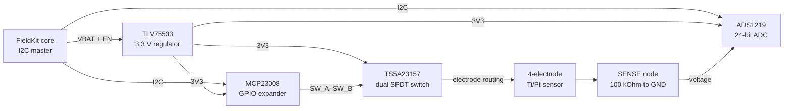

# PbSense: a lead sensor module for FieldKit


> Electronics for continuous, point-of-use lead screening in water, built as a plug-in module for the open-source [FieldKit](https://www.fieldkit.org) environmental monitoring platform.

<!-- Add a PCB render or photo, then uncomment:

-->

Senior design project, NJIT Electrical and Computer Engineering (ECE 416, Fall 2026).

## Why this exists

Lead in drinking water is a serious health risk, and the EPA action level is 15 ppb. The standard lab methods (ICP-MS, AAS) are accurate but slow and expensive, and they need samples sent away. This project builds the electronics that run a published four-electrode thin-film lead sensor continuously, on site, inside a FieldKit station.

It is a screening tool, not a certified test. See [Limitations](#limitations-and-honest-notes).

## How it works

The sensor is a four-electrode platinum thin-film device from published University of Michigan research (see [References](#references)). When a DC voltage is applied, lead ions deposit as conductive lead oxide on the anode. Over hours to days the deposit bridges a micron-scale gap to the neighboring floating electrode, the resistance drops, and the voltage across a 100 kOhm series resistor rises above a 1 V threshold.

The sensor is read in three modes, selected by switching which electrodes connect to the supply and the return:

| Mode | Positive electrode | Return electrode | Purpose |
|---|---|---|---|
| Normal operation | Anode | Cathode | Deposition (runs for most of the cycle) |
| Lead check | Anode | Floating electrode 2 | Lead-specific reading |
| Other metals check | Floating electrode 3 | Cathode | Detects other heavy metals |

The module has no microcontroller of its own. The FieldKit core talks to it over I2C.



## Hardware

| Item | Details |
|---|---|
| Board | 2 layers, 95 x 25 mm, 1.6 mm, 8 mil track and clearance |
| FieldKit interface | 12-pin Harwin M20-7810645R: I2C, 3.7 V battery bus, GND, enable |
| Power | 3.7 V bus, local 3.3 V regulator switched by the enable pin |
| Sensor connector | 4-pin JST PH, right angle, surface mount |
| ADC reference | Supply (REFP to 3V3), so the sensor loop and ADC track together |
| Fabrication | Gerbers and drill files in `hardware/fabrication/` |

Key parts:

| Ref | Part | Role |
|---|---|---|
| U1 | MCP23008-E/SO | I2C GPIO expander, drives the mode switches |
| U2 | TS5A23157DGSR | Dual SPDT analog switch, break-before-make, routes electrodes |
| U3 | ADS1219IPWT | 24-bit I2C ADC, reads the sense voltage |
| U4 | TLV75533PDBVR | 3.3 V LDO, enabled by the FieldKit enable pin |
| J1 | JST S4B-PH-SM4-TB | Sensor connector |
| J2 | Harwin M20-7810645R | FieldKit backplane connector |
| R_Sense1 | 100 kOhm, 0603 | Sense resistor |

Passives are 0603: 100 nF decoupling, 1 uF on the regulator, and 100 kOhm pull-downs. The full list is in `hardware/bom.csv`.

## Firmware

Current firmware is an ESP32 breadboard demo in `firmware/breadboard_demo/`. It cycles the three modes through an MCP23008, reads a resistor divider on GPIO34 (standing in for the ADS1219), and compares the reading to the 1 V threshold. Driver code for the FieldKit core is planned.

## Status

- [x] System architecture and component choices, confirmed with the FieldKit team
- [x] Breadboard measurement chain working with stand-in resistors
- [x] Schematic complete
- [x] PCB layout complete, DRC clean
- [x] Fabrication files exported
- [x] PCB ordered and assembled
- [x] ADS1219 and analog switch bring-up on the real board
- [x] Sensor tests in salt water and metal solutions
- [x] Lead solution tests (15 and 150 ppb)
- [x] FieldKit core driver

## Results

<!-- Replace with your measured data, for example:
| Liquid | Pair | Supply (V) | 10 s | 30 s | 60 s |
|---|---|---|---|---|---|
-->

Results will be added here as testing finishes.

## Repository layout

```
hardware/    KiCad project, fabrication files, BOM, images
firmware/    Arduino/ESP32 demo sketches
docs/        design notes, test log, references
data/        measurement logs (CSV)
```

## Building it

1. Open `hardware/lead_sensor_module.kicad_pro` in KiCad 10.
2. Fabrication files are in `hardware/fabrication/` and can be uploaded directly to a board house (2 layers, 1.6 mm).
3. Order the parts in `hardware/bom.csv`. The 0.5 mm pitch VSSOP-10 (U2) is the hardest part to hand solder.

## Limitations and honest notes

- The ADS1219 and the analog switch are designed in but not yet tested on hardware. The breadboard demo uses the ESP32's ADC, which reads about 0.14 V near zero.
- Real lead response is slow. The published sensor takes roughly a day or more at 150 ppb and longer at 15 ppb, so a quick bench test does not show lead detection.
- This is an educational prototype, not a certified test. Do not use it to decide whether water is safe. Use a certified lab.

## Safety

Lead standards are hazardous. Wear gloves and eye protection, label everything, and dispose of lead-containing liquids as hazardous waste through your institution's EHS office.

## References

- W.-C. Lin, Z. Li, M. A. Burns, "A Drinking Water Sensor for Lead and Other Heavy Metals," *Analytical Chemistry* 89, 8748-8756 (2017). DOI: 10.1021/acs.analchem.7b00843
- A. M. Nelson, S. Habibi, J. Lee, M. A. Burns, "Electrochemical Deposition of Lead for Water Quality Sensing," *Journal of The Electrochemical Society* 169, 017505 (2022). DOI: 10.1149/1945-7111/ac4932
- [FieldKit](https://www.fieldkit.org), open-source environmental monitoring platform
- [fieldkit/darwin-weather-module](https://github.com/fieldkit/darwin-weather-module), reference module design

## Team

Aden Agboola NJIT ECE.

Thanks to our faculty advisor and the FieldKit engineering team for the sensor, the module specification, and their guidance.

## License

Hardware: CERN-OHL-P-2.0. Firmware: MIT. See `LICENSE`.
